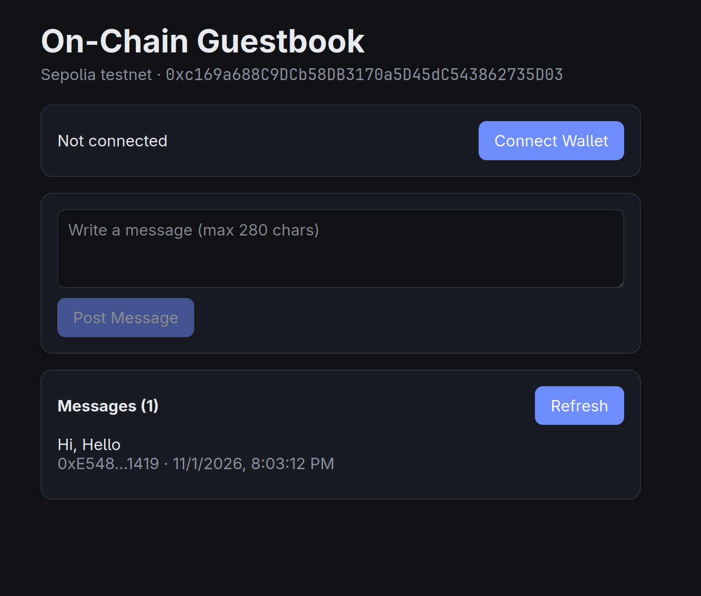

# On-Chain Guestbook DApp

## Description
A simple decentralized guestbook. Anyone with a wallet can post a short message to a Solidity smart contract on the Sepolia testnet; all messages are read back from the chain and shown in the UI.

## Features
- Solidity smart contract (`postMessage`, `getMessages`, `count`)
- Connect MetaMask, auto-switch to Sepolia
- Post a message (on-chain transaction)
- View all messages with author and timestamp
- ethers.js v6, plain HTML/CSS/JS (no build step)

## Contract
- **Network:** Sepolia
- **Address:** `0xYOUR_CONTRACT_ADDRESS`
- **Etherscan:** https://sepolia.etherscan.io/address/0xYOUR_CONTRACT_ADDRESS

## Deploy the Smart Contract
Prereqs: Node.js 18+, MetaMask with Sepolia ETH (any Sepolia faucet).

```bash
git clone <your-repo-url> && cd <repo>
npm install
cp .env.example .env      # set PRIVATE_KEY (testnet wallet only) and RPC_URL
npx hardhat compile
npm run deploy            # prints the contract address
```

Alternative: paste `contracts/Guestbook.sol` into https://remix.ethereum.org, compile, deploy with "Injected Provider - MetaMask" on Sepolia.

Then set `CONTRACT_ADDRESS` in `frontend/index.html` and update this README.

## Run the Frontend
```bash
cd frontend
npx serve .        # or: python3 -m http.server 8000
```
Open the printed URL, click **Connect Wallet**, write a message, click **Post Message**.

## Screenshots


## Tech
Solidity 0.8.20 · Hardhat · ethers.js 6 · MetaMask · Sepolia
